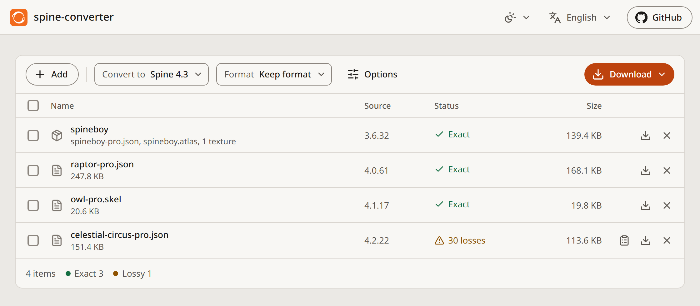

<div align="center">


# spine-converter

Spine skeleton data converter for versions 3.5 to 4.3

[](https://mindsmaster.github.io/spine-converter/)

[](docs/conversion.md)
[](#features)
[](#interfaces)
[](docs/stability.md)
[](https://ziglang.org)
[](#license)

[](https://www.npmjs.com/package/spine-converter)
[](https://pypi.org/project/spine-converter/)
[](https://www.nuget.org/packages/SpineConverter)

[](mailto:an5w1r@163.com)
[](https://discord.invite.azuramc.cc)
[](https://qun.qq.com/universal-share/share?ac=1&authKey=QEsKQUh0Z2dhNgn2lQDrnRRGD0MALQvTfF3FPr5ZYOv8i/lKdNp8G6gjTgYrD/Rw&busi_data=eyJncm91cENvZGUiOiIxMDQ2MDQ4Mjk3IiwidG9rZW4iOiJRR3lINzRUTUt0U2M0bDRkeTRhTERCT0ZscFlsTUxBNm9TdjUwelYxZXN2dzdUWUlyWnY0Mi9oOHI3c2JBOEYrIiwidWluIjoiMTE3MzM0ODYxMCJ9&data=EuNu7PewjDdMH0GF2GuEOYyIXT8iT25RJajcGVD3qL5LXkiATxSyzB-gdxqgbbFkbRvkyzoiJQ_sJ8-tBfFbSuW4NYFdjzdIr5Z1E8reAiM&svctype=5&tempid=h5_group_info)

[English](README.md) | [中文](README.zh-CN.md)

</div>

spine-converter converts [Spine](https://esotericsoftware.com) skeleton data and texture atlases between Spine versions 3.5 and 4.3. It is not affiliated with Esoteric Software.

## Web app

The [web app](https://mindsmaster.github.io/spine-converter/) converts files in the browser without installation. It accepts files, folders and `.zip` archives, groups each skeleton with its atlas and textures, and downloads the results one at a time or as a ZIP. Conversion runs in WebAssembly inside the page.

<a href="https://mindsmaster.github.io/spine-converter/">
<picture>
  <source media="(prefers-color-scheme: dark)" srcset=".github/web-dark.png">
  
</picture>
</a>

## Features

| Feature | Description |
|---|---|
| Version conversion | Upgrade and downgrade between 3.5, 3.6, 3.7, 3.8, 4.0, 4.1, 4.2 and 4.3, including beta exports from the frozen format of each minor version |
| Format conversion | JSON to binary and binary to JSON |
| Atlas conversion | 3.x and 4.x atlas formats |
| Rewrites | Data whose runtime behavior changed between versions is restructured so the target runtime produces the source pose |
| Report | Every dropped, approximated or rewritten item, with its impact and remedy |
| Verification | Source and converted data are posed by the official runtime of each version and compared frame by frame |

## Interfaces

An application that ships one Spine runtime version can convert exports of other versions at load time through a library, or convert files ahead of time with the CLI or the web app.

| Interface | Platforms | Documentation |
|---|---|---|
| Web app | current browsers | [Web app](#web-app) |
| CLI | Windows x64, x86 and arm64, macOS and Linux x64 and arm64 | [Command line](#command-line) |
| C | same platforms, shared and static | [bindings/c](bindings/c/README.md) |
| C++ | same platforms, header only | [bindings/cpp](bindings/cpp/README.md) |
| C# | .NET Standard 2.1 and .NET 8 | [bindings/csharp](bindings/csharp/README.md) |
| JavaScript and TypeScript | browsers and Node 18 or later, WebAssembly | [bindings/js](bindings/js/README.md) |
| Python | 3.10 and later, wheels for the CLI platforms | [bindings/python](bindings/python/README.md) |
| Zig | Zig 0.17 | [bindings/zig](bindings/zig/README.md) |
| Unity | 2021.2 and later, desktop editors and players, Android and iOS players | [bindings/unity](bindings/unity/README.md) |
| Godot | 4.3 and later, desktop, Android and iOS | [bindings/godot](bindings/godot/README.md) |

## Packages

The JavaScript, Python and C# bindings are published to their registries. The CLI, C, C++, Unity and Godot come from the GitHub release.

| Registry | Package | Install |
|---|---|---|
| npm | [spine-converter](https://www.npmjs.com/package/spine-converter) | `npm install spine-converter` |
| PyPI | [spine-converter](https://pypi.org/project/spine-converter/) | `pip install spine-converter` |
| NuGet | [SpineConverter](https://www.nuget.org/packages/SpineConverter) | `dotnet add package SpineConverter` |

## Downloads

Each GitHub release carries every file below, including the registry packages for offline installs.

| File | Content | Install |
|---|---|---|
| `spine-converter-<version>-<platform>.zip` or `.tar.gz` | CLI, shared and static library, C and C++ headers | extract |
| `spine-converter-<version>-android.tar.gz` | shared library per Android ABI, C and C++ headers | extract |
| `spine-converter-<version>-ios.tar.gz` | static XCFramework for devices and the simulator with C and C++ headers | add it to the Xcode target |
| `spine-converter-<version>-wasm32.wasm` | WebAssembly module | load directly |
| `spine-converter-<version>-npm.tgz` | npm package | `npm install ./<file>` |
| `SpineConverter.<version>.nupkg` | NuGet package | add the folder as a package source |
| `spine_converter-<version>-py3-none-<tag>.whl` | Python wheel per platform | `pip install ./<file>` |
| `cc.azuramc.spine-converter-<version>.tgz` | Unity package | Add package from tarball |
| `spine-converter-<version>-godot.zip` | Godot addon | extract into the project folder |
| `SHA256SUMS` | SHA-256 of every file | `sha256sum -c SHA256SUMS` |

`<platform>` is `<os>-<arch>`. Windows archives are `.zip`, the others `.tar.gz`. The CLI is `bin/spine-converter`, with `.exe` on Windows.

| Platform | Minimum |
|---|---|
| `windows-x64` `windows-x86` `windows-arm64` | Windows 10 |
| `macos-x64` | macOS 10.15 |
| `macos-arm64` | macOS 11 |
| `linux-x64` `linux-arm64` | any libc, glibc or musl |
| `android` arm64-v8a and x86_64 | Android 5.0 |
| `ios` | iOS 12, Apple silicon simulator iOS 14 |

## Command line

```
spine-converter detect hero.skel
spine-converter convert hero.skel hero-43.skel --to 4.3
spine-converter convert hero.json hero-38.skel --to 3.8 --binary
spine-converter convert hero.atlas hero-38.atlas --to 3.8
```

| Flag | Effect |
|---|---|
| `--to <version>` | Target version such as 4.3 or 3.8.99 |
| `--json` `--binary` | Target format, the source format by default, not for atlases |
| `--pretty` | Indented JSON output |
| `--fail-on-loss` | Fail instead of writing a lossy result |
| `--no-rewrite` | Keep the source structure and report what a rewrite would make exact |
| `--atlas <file>` | Atlas of a 3.5 or 3.6 skeleton, keeps the mesh UVs of stripped unrotated regions |

| Exit status | Meaning |
|---|---|
| 0 | Written without loss |
| 1 | Error |
| 2 | Usage error |
| 3 | Written with losses, listed on stderr |

## Limitations

| Case | Behavior |
|---|---|
| Runtime behavior that the target data cannot represent | Reported, see [docs/conversion.md](docs/conversion.md#limits) |
| Features missing in an older target, such as physics and sliders | Dropped or approximated and reported |
| `.spine` project files | Not supported |
| Runtime state such as skeleton flip, AnimationState mixing | Out of scope |

## Documentation

| Document | Content |
|---|---|
| [docs/conversion.md](docs/conversion.md) | What a conversion keeps, rewrites and reports |
| [docs/report.md](docs/report.md) | Report format and codes |
| [docs/stability.md](docs/stability.md) | Compatibility rules between releases |
| [CONTRIBUTING.md](CONTRIBUTING.md) | Building, testing, the design documents and reporting issues |

## License

| Files | License |
|---|---|
| Files with the Spine Runtimes License header, `oracle/patches` | [Spine Runtimes License](LICENSE) |
| All other files | [MIT](LICENSE-MIT) |

The libraries, the CLI and the packages built from this repository contain code derived from the Spine Runtimes and are distributed under the Spine Runtimes License. Each user must have their own [Spine Editor license](https://esotericsoftware.com/spine-purchase).

Spine is a registered trademark of Esoteric Software.
