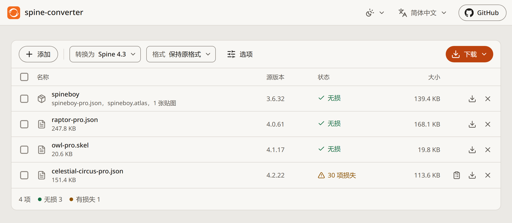

<div align="center">


# spine-converter

Spine 3.5 至 4.3 骨骼数据转换工具

[](https://mindsmaster.github.io/spine-converter/)

[](docs/conversion.zh-CN.md)
[](#功能)
[](#接口)
[](docs/stability.zh-CN.md)
[](https://ziglang.org)
[](#许可)

[](https://www.npmjs.com/package/spine-converter)
[](https://pypi.org/project/spine-converter/)
[](https://www.nuget.org/packages/SpineConverter)

[](mailto:an5w1r@163.com)
[](https://discord.invite.azuramc.cc)
[](https://qun.qq.com/universal-share/share?ac=1&authKey=QEsKQUh0Z2dhNgn2lQDrnRRGD0MALQvTfF3FPr5ZYOv8i/lKdNp8G6gjTgYrD/Rw&busi_data=eyJncm91cENvZGUiOiIxMDQ2MDQ4Mjk3IiwidG9rZW4iOiJRR3lINzRUTUt0U2M0bDRkeTRhTERCT0ZscFlsTUxBNm9TdjUwelYxZXN2dzdUWUlyWnY0Mi9oOHI3c2JBOEYrIiwidWluIjoiMTE3MzM0ODYxMCJ9&data=EuNu7PewjDdMH0GF2GuEOYyIXT8iT25RJajcGVD3qL5LXkiATxSyzB-gdxqgbbFkbRvkyzoiJQ_sJ8-tBfFbSuW4NYFdjzdIr5Z1E8reAiM&svctype=5&tempid=h5_group_info)

[English](README.md) | [中文](README.zh-CN.md)

</div>

spine-converter 用于在 Spine 3.5 至 4.3 之间转换 [Spine](https://esotericsoftware.com) 骨骼数据和纹理图集。本项目与 Esoteric Software 无关。

## 网页版

[网页版](https://mindsmaster.github.io/spine-converter/)在浏览器中直接转换，无需安装。可添加文件、文件夹和 `.zip` 压缩包，每个骨骼与其图集、贴图归为一组，结果可逐个下载或打包为 ZIP。转换在页面内通过 WebAssembly 完成。

<a href="https://mindsmaster.github.io/spine-converter/">
<picture>
  <source media="(prefers-color-scheme: dark)" srcset=".github/web-dark.zh-CN.png">
  
</picture>
</a>

## 功能

| 功能 | 说明 |
|---|---|
| 版本转换 | 在 3.5、3.6、3.7、3.8、4.0、4.1、4.2、4.3 之间升级和降级，含各小版本格式冻结后的 beta 导出 |
| 格式转换 | JSON 与二进制互转 |
| 图集转换 | 3.x 与 4.x 图集格式 |
| 改写 | 版本间运行时行为变化的数据会被重组，使目标运行时得到与源数据相同的姿势 |
| 报告 | 列出每一项丢弃、近似或改写的内容，及其影响和处理方式 |
| 验证 | 用各版本的官方运行时分别计算源数据和转换结果的姿势，逐帧比对 |

## 接口

只带一个 Spine 运行时版本的应用，可以在加载时通过库把其他版本的导出转换为该版本，也可以用命令行工具或网页版预先转换文件。

| 接口 | 平台 | 文档 |
|---|---|---|
| 网页版 | 主流浏览器 | [网页版](#网页版) |
| 命令行 | Windows x64、x86 与 arm64，macOS 与 Linux x64 与 arm64 | [命令行](#命令行) |
| C | 同上，提供动态库和静态库 | [bindings/c](bindings/c/README.zh-CN.md) |
| C++ | 同上，纯头文件 | [bindings/cpp](bindings/cpp/README.zh-CN.md) |
| C# | .NET Standard 2.1 与 .NET 8 | [bindings/csharp](bindings/csharp/README.zh-CN.md) |
| JavaScript 与 TypeScript | 浏览器与 Node 18 及以上，WebAssembly | [bindings/js](bindings/js/README.zh-CN.md) |
| Python | 3.10 及以上，各命令行平台的 wheel | [bindings/python](bindings/python/README.zh-CN.md) |
| Zig | Zig 0.17 | [bindings/zig](bindings/zig/README.zh-CN.md) |
| Unity | 2021.2 及以上，桌面编辑器与播放器，Android 播放器 | [bindings/unity](bindings/unity/README.zh-CN.md) |
| Godot | 4.3 及以上，桌面平台与 Android | [bindings/godot](bindings/godot/README.zh-CN.md) |

## 软件包

JavaScript、Python 和 C# 绑定已发布到各自的软件包仓库。命令行工具、C、C++、Unity 和 Godot 从 GitHub Release 获取。

| 仓库 | 包 | 安装 |
|---|---|---|
| npm | [spine-converter](https://www.npmjs.com/package/spine-converter) | `npm install spine-converter` |
| PyPI | [spine-converter](https://pypi.org/project/spine-converter/) | `pip install spine-converter` |
| NuGet | [SpineConverter](https://www.nuget.org/packages/SpineConverter) | `dotnet add package SpineConverter` |

## 下载

每个 GitHub Release 都包含以下全部文件，其中也有上述软件包，可用于离线安装。

| 文件 | 内容 | 安装 |
|---|---|---|
| `spine-converter-<version>-<platform>.zip` 或 `.tar.gz` | 命令行工具、动态库与静态库、C 与 C++ 头文件 | 解压 |
| `spine-converter-<version>-wasm32.wasm` | WebAssembly 模块 | 直接加载 |
| `spine-converter-<version>-npm.tgz` | npm 包 | `npm install ./<file>` |
| `SpineConverter.<version>.nupkg` | NuGet 包 | 将所在目录添加为包源 |
| `spine_converter-<version>-py3-none-<tag>.whl` | 各平台的 Python wheel | `pip install ./<file>` |
| `cc.azuramc.spine-converter-<version>.tgz` | Unity 包 | Add package from tarball |
| `spine-converter-<version>-godot.zip` | Godot 插件 | 解压到项目目录 |
| `SHA256SUMS` | 所有文件的 SHA-256 | `sha256sum -c SHA256SUMS` |

`<platform>` 为 `<os>-<arch>`。Windows 使用 `.zip`，其他平台使用 `.tar.gz`。命令行工具为 `bin/spine-converter`，Windows 上带 `.exe`。

| 平台 | 最低版本 |
|---|---|
| `windows-x64` `windows-x86` `windows-arm64` | Windows 10 |
| `macos-x64` | macOS 10.15 |
| `macos-arm64` | macOS 11 |
| `linux-x64` `linux-arm64` | 任意 libc，glibc 或 musl |

## 命令行

```
spine-converter detect hero.skel
spine-converter convert hero.skel hero-43.skel --to 4.3
spine-converter convert hero.json hero-38.skel --to 3.8 --binary
spine-converter convert hero.atlas hero-38.atlas --to 3.8
```

| 参数 | 作用 |
|---|---|
| `--to <version>` | 目标版本，如 4.3 或 3.8.99 |
| `--json` `--binary` | 目标格式，默认与源文件相同，不适用于图集 |
| `--pretty` | JSON 输出带缩进 |
| `--fail-on-loss` | 有损失时失败，不写出结果 |
| `--no-rewrite` | 保留源数据结构，并报告改写可精确处理的项 |
| `--atlas <file>` | 3.5 或 3.6 骨骼对应的图集，保留裁剪且未旋转区域上网格的 UV |

| 退出码 | 含义 |
|---|---|
| 0 | 已写出，无损失 |
| 1 | 错误 |
| 2 | 用法错误 |
| 3 | 已写出，有损失，详见 stderr |

## 限制

| 情况 | 处理 |
|---|---|
| 目标版本数据无法表达的运行时行为 | 报告，见 [docs/conversion.zh-CN.md](docs/conversion.zh-CN.md#限制) |
| 旧版本不具备的功能，如物理和滑块 | 丢弃或近似，并报告 |
| `.spine` 工程文件 | 不支持 |
| 骨架翻转等运行时状态、AnimationState 混合 | 不在范围内 |

## 文档

| 文档 | 内容 |
|---|---|
| [docs/conversion.zh-CN.md](docs/conversion.zh-CN.md) | 转换保留、改写和报告的内容 |
| [docs/report.zh-CN.md](docs/report.zh-CN.md) | 报告格式与代码 |
| [docs/stability.zh-CN.md](docs/stability.zh-CN.md) | 版本间兼容规则 |
| [CONTRIBUTING.zh-CN.md](CONTRIBUTING.zh-CN.md) | 构建、测试、设计文档与提交问题 |

## 许可

| 文件 | 许可 |
|---|---|
| 带 Spine Runtimes License 文件头的文件、`oracle/patches` | [Spine Runtimes License](LICENSE) |
| 其他所有文件 | [MIT](LICENSE-MIT) |

由本仓库构建的库、命令行工具和软件包包含源自 Spine Runtimes 的代码，按 Spine Runtimes License 分发。每位使用者须持有自己的 [Spine 编辑器许可](https://esotericsoftware.com/spine-purchase)。

Spine 是 Esoteric Software 的注册商标。
